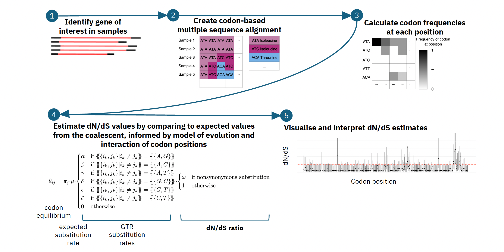

Overview
============

We have developed a new tool called TOMBOMBADIL (Tree-free Omega Mapping By Observing Mutations of Bases and Amino acids Distributed Inside Loci), which computes dN/dS directly from codon counts from alignments by comparing to expected frequencies from the coalescent. We implemented TOMBOMBADIL as an end-to-end differentiable model in JAX, which is a Python library that parallelises code automatically, on both CPU and GPU, allowing us to estimate dN/dS values across genes for alignments with potentially millions of samples. TOMBOMBADIL is based on an GTR-based codon evolution model and includes different dN/dS models that reflect assumptions of how codons evolve. 

Analysis workflow with TOMBOMBADIL
----------------------------

An overview of the analysis workflow with TOMBOMBADIL can be found below. The user determines the samples and constructs the codon-based multiple sequence alignment (eg with revtrans), the rest of the analysis is automatised in TOMBOMBADIL.

Fitting dN/dS model to data
----------------------------

0. Install TOMBOMBADIL

1. Create codon-based multiple sequence alignments

2. Estimate dN/dS using TOMBOMBADIL by running one of the following commands 

python -m tombombadil --alignment alignment.fas.aln --fit-replicates 4 --fit-until-convergence --output-jax output.txt

python -m tombombadil --alignment alignment.fas.aln --omega-mode per-site --output-jax output

python -m tombombadil --alignment alignment.fas.aln --omega-mode per-site --domains domains.json --reference reference.faa

python -m tombombadil --alignment alignment.fas.aln --fit-method nuts --num-warmup 100 --num-samples 100 --num-chains 4 --output-jax output.txt --cpus 4 --nuts-chain-mode pmap

python -m tombombadil --alignment alignment.fas.aln --omega-mode per-site --fit-method nuts --num-warmup 100 --num-samples 100 --num-chains 4 --output-jax output.txt --cpus 4 --nuts-chain-mode pmap

Advanced options
----------------------------

--convergence-tol x default=1e-6

--sample-it x number of sampling steps

--platform gpu/cpu/tpu

--cpus x default=1 number of cpus for CPU pmap chains

--pi uniform/empirical/F3x4 default=uniform codon equilibrium frequencies

--pi-pseudocount x default=0.5 pseudocount for empirical and F3x4 codon frequencies

